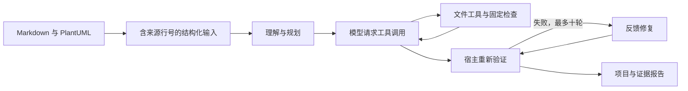

# DesignCodeAgent

面向两份 Markdown 架构文档的代码生成工具：通过真实文件工具创建 Node.js 项目，执行检查，并根据实际失败反馈修复。Windows 桌面程序自带 Python 运行时。

v0.3 提供两个独立程序，分别验收：

| 程序 | 用途 |
| --- | --- |
| `DesignCodeAgent.exe` | 正式工具：设计来源追溯、任务依赖、候选修改门禁、真实检查与最多十轮反馈修复 |
| `DesignCodeAgent-Superagent.exe` | 架构原型：独立模型会话、最多两个隔离执行者、SQLite 调度与恢复、按需资源读取和只读审查 |

主工具保留单控制器结构；原型借鉴 DeepSeek Super-agent 的公开系统设计，使用相同的百炼 `deepseek-v4-pro-0813`，不作为新的基础模型或性能优势声明。原型的运行结果不计入正式工具成绩。

[当前验证与全部原始记录](docs/v03-validation.md) · [温度转换器完整生成示例](examples/temperature-converter/README.md) · [Space 反馈续跑示例](examples/space-fractions-v03/README.md) · [Super-agent 实跑与限制](docs/superagent-results.md)

历史 v0.2 九次冻结实验、人工修正的 Space Fractions 交付副本及失败记录均保留，见 [v0.2 结果](docs/v02-results.md)。当前版本不引用旧成绩证明新程序能力。

## 快速开始

Windows 用户从 [Releases](https://github.com/RolandHuang17/design-code-agent/releases) 下载发布压缩包，解压后双击 `main/DesignCodeAgent.exe`；架构原型位于 `prototype/DesignCodeAgent-Superagent.exe`。桌面工具自带 Python 运行时，无需预装 Python；联网生成仍需模型服务密钥。生成项目的构建与运行另需 Node.js / Docker。

1. 选择平台并填写匹配地域的 Base URL。官方模式为 `https://api.deepseek.com`；百炼选择控制台给出的 OpenAI 兼容地址，结尾为 `/compatible-mode/v1`。
2. 在遮蔽输入框粘贴 API Key，或点击“读取环境变量”：官方使用 `DEEPSEEK_API_KEY`，百炼使用 `DASHSCOPE_API_KEY`。可另配 `DASHSCOPE_BASE_URL`。密钥默认仅在内存使用。Windows 微软拼音请先切换英文，建议使用粘贴或读取环境变量；输入法尚未提交的组合候选窗口不受文本框遮蔽保护。
3. 核对当前模型价格上界并勾选确认，点击“测试连接”。输入、输出单价均为**元 / 百万 tokens**。
4. 选择 `Architecture_Documentation.md`、`Architecture_View.md` 和输出目录。先点“解析预览”可免费检查文档。
5. 新文档选择 `generic-node`；原始游戏材料选择 `space-fractions`，借阅案例选择 `library`。案例模式会加载另存来源的接口补充。点击“开始生成”。若需自动安装依赖并执行生成项目测试，勾选对应执行选项。此功能以当前用户权限运行生成代码，**不是系统沙箱**；建议在专门开发环境使用。
6. 通过“打开结果目录”查看生成项目、原始输入、事件日志和验证报告。取消会停止本地等待；远端请求可能继续完成，不确定费用预留会保留。单次请求整体等待上限 300 秒。

每次创建独立任务目录，不覆盖之前的项目。Windows 中文及空格路径受支持。本次实验配置为百炼 `deepseek-v4-pro-0813`，平台、型号和用量记录在运行报告中。

## 从源码运行

需要 Python 3.12+。推荐 Windows Python 3.12、Node.js 22+。

```powershell
python -m venv .venv
.venv/Scripts/python.exe -m pip install -r requirements-dev.txt
.venv/Scripts/python.exe -m codeagent gui
.venv/Scripts/python.exe -m pytest -q
```

免费解析：

```powershell
.venv/Scripts/python.exe -m codeagent inspect Architecture_Documentation.md Architecture_View.md
```

官方真实生成（原始游戏案例，事先配置用户环境变量密钥，价格确认以执行当日为准）：

```powershell
.venv/Scripts/python.exe -m codeagent run Architecture_Documentation.md Architecture_View.md --confirm-pricing --acceptance-profile space-fractions --allow-project-execution --output runs
```

百炼真实生成（示例地址中替换自己的业务空间；北京单价上界须核对）：

```powershell
.venv/Scripts/python.exe -m codeagent run Architecture_Documentation.md Architecture_View.md --provider bailian --base-url https://YOUR-WORKSPACE.cn-beijing.maas.aliyuncs.com/compatible-mode/v1 --model deepseek-v4-pro-0813 --input-price 12 --output-price 27 --confirm-pricing --acceptance-profile space-fractions --allow-project-execution --output runs
```

上述命令会付费并执行生成项目脚本。取消按 Ctrl+C，等待结果落盘。连接测试可将 `run` 和两个文档路径替换为 `connection`，保留平台、计价参数。

## Agent 工作机制

v0.2 将通用控制器和案例补充输入分离。界面可选择 `space-fractions`、`library` 或 `generic-node` 验收方案，并设定 0–10 轮修复（默认3轮）。案例补充材料会与两份原始输入分别保存并标明来源，不属于原始设计。`runtime` 检查会自动启动独立 Docker Compose 项目，在临时回环端口执行项目外 HTTP 验收，返回启动/SQL/功能失败用于修复，随后清理本次资源；没有可用引擎则标记未验证。本机优先 Docker CLI，其次现有 WSL Ubuntu Docker。

CLI 对应参数：`--acceptance-profile library --max-repair-rounds 3 --runtime-backend auto`。`--max-repair-rounds 0` 用于不反馈修复的对照。选择 `generic-node` 只进行通用检查，没有独立领域运行验收，不能据此宣称业务功能通过。



单一控制器按阶段组织任务，并非多进程多智能体系统。规划后的生成按任务逐项推进；模型通过工具创建、读取和修改真实文件。宿主独立执行检查，不能由模型自行宣布“测试通过”。完整工具交换按轮保留；上下文达到字节阈值时由原始输入、保存计划、文件进度与最近检查重建，不凭空伪造工具消息。

失败后可在 CLI 加 `--seed-project 上一轮/project` 续跑：复制原始输出到全新 run，记录来源和文件哈希，跳过已具备目标文件的任务，再进行完整验证。文件存在不视为测试通过；原始运行不被覆盖。桌面 GUI 当前只支持新建任务。

独立验收发现问题后，可再加 `--feedback findings.json`，文件为检查对象数组（例如 `[{"profile":"database_restart","details":"实际失败输出及预期行为"}]`）。反馈触发所配置修复轮次中的一轮；结果保留“外部复验待完成”状态，必须由原验收重新检查，不能由模型自行宣布修复成功。

工具包括原始设计分页读取 `read_source`，以及 `list_files`、`read_file`、`write_file`、`edit_file`、关联文件变更集 `apply_changes` 和 `run_check`。修改文件需先读取并校验哈希；局部替换要求唯一匹配。候选修改先通过JS语法／JSON／YAML格式门禁，再接受到工作目录；检查绑定代码快照。对于文档中识别到的通用HTTP项目，另执行真实 npm start 就绪探测，不将其等同于业务正确性。检查类型固定为静态语法、依赖安装、单元测试、HTTP 集成测试、构建、Compose 配置和当前案例的独立 JWT 验收。安装禁用生命周期脚本；测试 / 构建及 JWT 检查会执行生成代码。

容器启动失败时，宿主只读取本次 Compose 项目的容器状态和健康检查输出，将具体失败返回给模型。同一代码快照在模型修复阶段最多实际执行两次运行验收，之后明确复用已有证据；修改代码后重新计数，最终宿主验证始终实际重跑。

## 输出和证据

```text
run-时间-随机编号/
  inputs/                 原文副本
  project/                模型生成的项目
  artifacts/
    structured-input.json 含来源行号及输入哈希
    run-config.json       平台、模型、边界配置
    events.jsonl          脱敏模型工具交换与事件
    revisions/            每次写入的不可覆盖版本快照
    checks-0.json         宿主检查；后续编号对应修复轮次
    usage.json            有效响应的用量
    report.json           完整验证结果及累计费用
    report.md             可读报告
```

`passed` 代表相应检查实际运行且成功；`failed` 为失败；`unverified` 表示未运行或缺少条件。即使所有自动检查通过，最终也只标记 `checks_passed_requires_review`，不表示生产就绪。设计追溯自动检查仅验证来源行范围、文件链接和状态，语义覆盖还须独立审查。

## 预算与边界

- 默认累计上限 50 元，包含连接测试和此前运行；可调整为其他正数。明确取消金额上限可在界面填写 `不限`，CLI 使用 `--budget unlimited`，仍保留计价、用量和未知请求预留。本次实验未设金额上限，用量与未知请求预留持续记录。账本位于 `%LOCALAPPDATA%/DesignCodeAgent/budget.json`，没有界面内“重置费用”功能，原有费用不清零。
- 完整 Space Fractions 微服务案例较大，可将修复上限设为十轮并准备相应预算。本轮一次全新生成实际用了四轮修复、约85分钟，用量上界估算111.21元；HTTP通过后网页仍需独立验收。详见 [实跑记录](docs/v03-validation.md)，不保证其他输入具有相同耗时或结果。
- 请求前按 UTF-8 字节数加协议余量及输出上限预留；有 usage 才结算。超时、重试和不确定错误保留预留，因此可能比实际账单更保守。缓存折扣不用于预算放宽。
- 单价由用户核对确认。模型服务实际账单才是最终收费依据；价格上界失效时工具估算不能保证实际费用上限。
- 最多 300 个模型轮次，限流 / 指定服务端错误最多重试两次；无网络响应时不盲目重发。生成按规划任务中的目标文件逐一推进，并提供接口索引和读取次数限制，避免反复遍历仓库。输出截断时不执行任何残缺调用，最多提示缩小单次写入后重试两次；超出限制或上下文上限则停止并保留结果。每次尝试均计入预算。
- 文件工具限制在任务项目目录，禁止绝对路径、路径穿越、Windows 保留名、符号链接和 junction；检查子进程使用精简环境，不继承 API 密钥或 `NODE_OPTIONS`。
- API 域名限定为 DeepSeek / 阿里云，拒绝重定向，不使用系统代理；公司网络如要求代理，需调整部署环境后使用。执行生成代码仍具有当前用户权限，不能把文件工具边界当作代码执行隔离。

本项目使用 AI 辅助实现与测试，生成结果及人工修正来源见实验记录。

许可、输入材料权属与参考来源见 [来源说明](NOTICE.md)。
