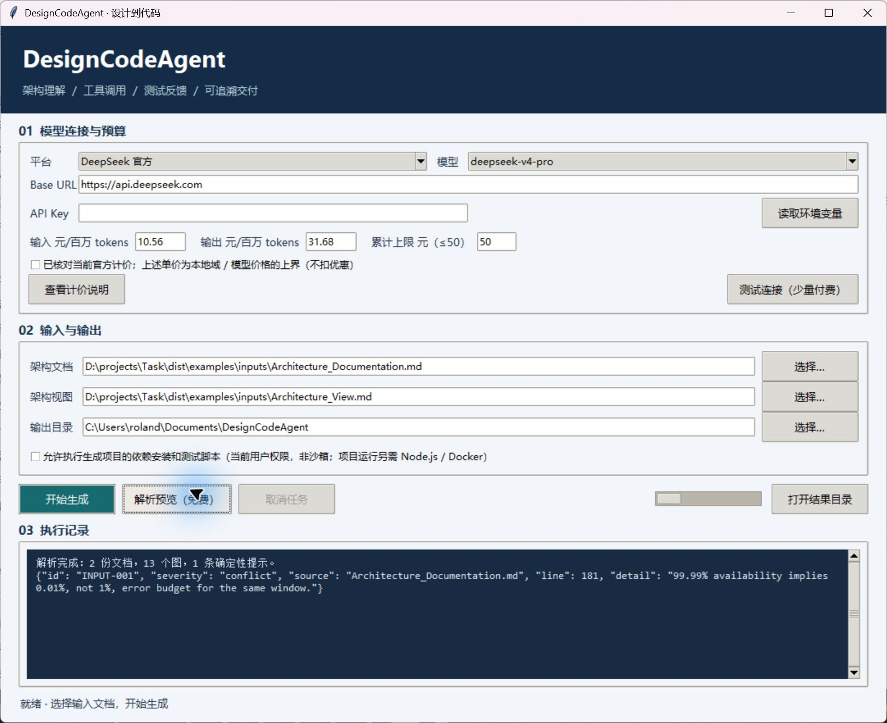

# DesignCodeAgent

一个面向架构文档的简易代码智能体：将 Markdown 架构文档和 PlantUML 架构视图转换为代码仓库，通过实际文件工具和检查反馈迭代修复。提供 Windows 桌面 GUI 和 CLI。

本项目用于 coding agent 作业。核心实现采用 Python / Tkinter；不依赖 Claude Code 安装，不使用预写的 Space Fractions 项目替代模型生成。



> 作业要求 DeepSeek 官方 `deepseek-v4-pro` API。工具保留官方模式，也应使用者要求支持阿里云百炼模式。**百炼属于第三方服务，百炼运行不能视为满足官方 API 条件。**报告自动记录平台、地址、模型及该差异。

## 快速开始

Windows 用户从 [Releases](https://github.com/RolandHuang17/design-code-agent/releases) 下载发布压缩包，解压后双击 `DesignCodeAgent.exe`。桌面工具自带 Python 运行时，无需预装 Python；联网生成仍需模型服务密钥。生成项目的构建与运行另需 Node.js / Docker。

1. 选择平台并填写匹配地域的 Base URL。官方模式为 `https://api.deepseek.com`；百炼选择控制台给出的 OpenAI 兼容地址，结尾为 `/compatible-mode/v1`。
2. 在遮蔽输入框粘贴 API Key，或点击“读取环境变量”：官方使用 `DEEPSEEK_API_KEY`，百炼使用 `DASHSCOPE_API_KEY`。可另配 `DASHSCOPE_BASE_URL`。密钥默认仅在内存使用。
3. 核对当前模型价格上界并勾选确认，点击“测试连接”。输入、输出单价均为**元 / 百万 tokens**。
4. 选择 `Architecture_Documentation.md`、`Architecture_View.md` 和输出目录。先点“解析预览”可免费检查文档。
5. 点击“开始生成”。若需自动安装依赖并执行生成项目测试，勾选对应执行选项。此功能以当前用户权限运行生成代码，**不是系统沙箱**；建议在专门开发环境使用。
6. 通过“打开结果目录”查看生成项目、原始输入、事件日志和验证报告。取消时等待当前网络请求结束，最长约 90 秒。

每次创建独立任务目录，不覆盖之前的项目。Windows 中文及空格路径受支持。

## 从源码运行

需要 Python 3.12+。推荐 Windows Python 3.12、Node.js 22+。

```powershell
python -m venv .venv
.venv/Scripts/python.exe -m pip install -r requirements-dev.txt
.venv/Scripts/python.exe -m codeagent gui
.venv/Scripts/python.exe -m pytest -q
```

免费解析：

```powershell
.venv/Scripts/python.exe -m codeagent inspect Architecture_Documentation.md Architecture_View.md
```

官方真实生成（事先配置用户环境变量密钥，价格确认以执行当日为准）：

```powershell
.venv/Scripts/python.exe -m codeagent run Architecture_Documentation.md Architecture_View.md --confirm-pricing --allow-project-execution --output runs
```

百炼真实生成（示例地址中替换自己的业务空间；北京单价上界须核对）：

```powershell
.venv/Scripts/python.exe -m codeagent run Architecture_Documentation.md Architecture_View.md --provider bailian --base-url https://YOUR-WORKSPACE.cn-beijing.maas.aliyuncs.com/compatible-mode/v1 --model deepseek-v4-pro-0813 --input-price 12 --output-price 27 --confirm-pricing --allow-project-execution --output runs
```

上述命令会付费并执行生成项目脚本。取消按 Ctrl+C，等待结果落盘。连接测试可将 `run` 和两个文档路径替换为 `connection`，保留平台、计价参数。

## Agent 工作机制


单一控制器按阶段组织任务，并非多进程多智能体系统。规划后的生成按任务逐项推进；模型通过工具创建、读取和修改真实文件。宿主独立执行检查，不能由模型自行宣布“测试通过”。完整工具交换按轮保留；上下文达到字节阈值时由原始输入、保存计划、文件进度与最近检查重建，不凭空伪造工具消息。

失败后可在 CLI 加 `--seed-project 上一轮/project` 续跑：复制原始输出到全新 run，记录来源和文件哈希，跳过已具备目标文件的任务，再进行完整验证。文件存在不视为测试通过；原始运行不被覆盖。桌面 GUI 当前只支持新建任务。

工具：`list_files`、`read_file`、`write_file`、`edit_file`、`run_check`。修改文件需先读取并校验哈希；局部替换要求唯一匹配。检查类型固定为静态语法、依赖安装、测试、构建、Compose 配置和当前案例的独立 JWT 验收。安装禁用生命周期脚本；测试 / 构建及 JWT 检查会执行生成代码。

## 输出和证据

```text
run-时间-随机编号/
  inputs/                 原文副本
  project/                模型生成的项目
  artifacts/
    structured-input.json 含来源行号及输入哈希
    run-config.json       平台、模型、边界配置
    events.jsonl          脱敏模型工具交换与事件
    revisions/            每次写入的不可覆盖版本快照
    checks-0.json         宿主检查；后续编号对应修复轮次
    usage.json            有效响应的用量
    report.json           完整验证结果及累计费用
    report.md             可读报告
```

`passed` 代表相应检查实际运行且成功；`failed` 为失败；`unverified` 表示未运行或缺少条件。即使所有自动检查通过，最终也只标记 `checks_passed_requires_review`，不表示生产就绪。设计追溯自动检查仅验证来源行范围、文件链接和状态，语义覆盖还须独立审查。

## 预算与边界

- 默认累计上限 50 元，包含连接测试和此前运行；账本位于 `%LOCALAPPDATA%/DesignCodeAgent/budget.json`。没有界面内“重置费用”功能。
- 请求前按 UTF-8 字节数加协议余量及输出上限预留；有 usage 才结算。超时、重试和不确定错误保留预留，因此可能比实际账单更保守。缓存折扣不用于预算放宽。
- 单价由用户核对确认。模型服务实际账单才是最终收费依据；价格上界失效时工具估算不能保证实际费用上限。
- 最多 130 个模型轮次，限流 / 指定服务端错误最多重试两次；无网络响应时不盲目重发。超出上下文或输出截断时停止并保留结果。
- 文件工具限制在任务项目目录，禁止绝对路径、路径穿越、Windows 保留名、符号链接和 junction；检查子进程使用精简环境，不继承 API 密钥或 `NODE_OPTIONS`。
- API 域名限定为 DeepSeek / 阿里云，拒绝重定向，不使用系统代理；公司网络如要求代理，需调整部署环境后使用。执行生成代码仍具有当前用户权限，不能把文件工具边界当作代码执行隔离。

## 构建与验证

```powershell
powershell -ExecutionPolicy Bypass -File scripts/build.ps1
```

输出为 `dist/DesignCodeAgent.exe`，同时附带示例输入和 SHA256 校验值。GitHub Actions 在 Windows 测试和打包，产出 exe 构建附件。发布包在本机生成；干净 Windows 验收状态见 [验证记录](docs/validation.md)。

更多材料：[机制调研](docs/research.md)、[架构与限制](docs/design.md)、[评价口径](docs/experiment-protocol.md)、[演示与讲解](docs/demo.md)、[实验记录](examples/README.md)。

## 许可与来源

工具原创实现采用 MIT 许可。老师提供的两份架构材料及作业说明保留原始内容，其权利归原作者所有，不纳入工具代码的 MIT 授权。参考仓库均列明实际访问情况；本项目不声称复现 Claude Code 全部能力。使用 AI 辅助实现与测试，真实 API 生成结果须以实验记录为证。
