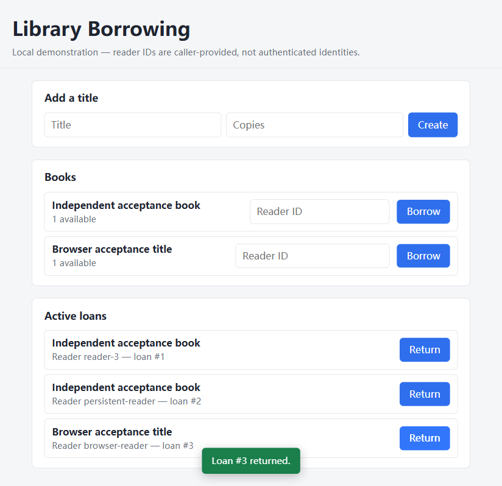
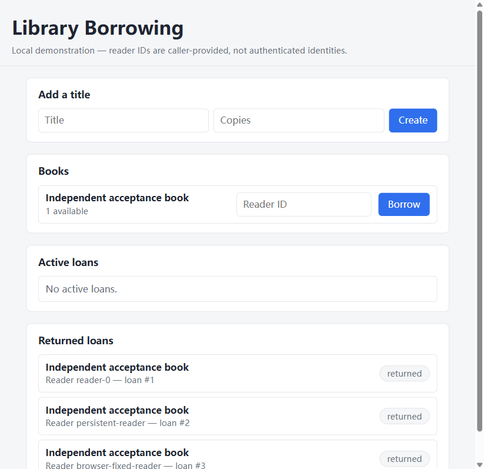

# 浏览器发现问题后的 Agent 修复示例

这是开发续跑的机制演示，**不计入正式空目录生成实验**。源项目、修复项目和第三方验收分别保留；没有人工编辑这条谱系的生成源码。

## 发现

开发试跑 `run-20261106-042915-a39e84d1` 的独立 Docker HTTP 检查12项通过，但真实浏览器发现：归还后接口状态为 `returned`，库存也恢复，页面仍将记录显示在“Active loans”下，保留“Return”按钮。

## 反馈与修复

操作者把实际操作、接口返回、截图位置和预期显示行为写成 `browser-feedback.json`，用 `--seed-project` 和 `--feedback` 开始全新运行 `run-20261106-044759-c995baaf`。Agent 读取并修改了 `public/index.html`、`public/app.js`、`public/style.css`，将活跃借阅和归还历史分开显示。

此轮保留 `completed_with_gaps`：宿主自动检查不能证明外部浏览器问题已修好，必须重新独立操作。不能把模型的修复说明自动转成“通过”。

## 独立复验

实际在 headed Chromium 中借出一本书，观察库存从1变0、记录出现在活跃区；点击归还再刷新，库存恢复为1，活跃区显示“No active loans”，该记录进入“Returned loans”并显示 returned。重新执行的 Docker HTTP 预检仍为12项通过。

这条开发谱系的项目自带测试为9项通过、27项因宿主无可用 PostgreSQL 跳过；独立 Docker HTTP 验收另行验证真实数据库，不将跳过计为通过。浏览器还有 favicon 404 的外观缺项，未伪装为零控制台错误。

逐次状态、用量和谱系见 [开发记录](../experiments/v02/development/summary.json)。原始工具交换、源码快照和 runtime 构建/启动/重启/清理输出随 v0.2 证据包交付。
