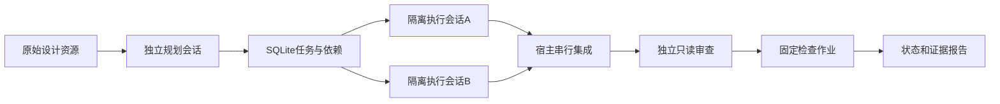

# Super-agent 架构原型

`DesignCodeAgent-Superagent.exe` 是独立于正式工具的研究原型。模型固定为百炼 `deepseek-v4-pro-0813`；不是新模型、上游 Harness 的移植版或完整复现，也不以原型结果证明生成能力优于正式工具。

参考 [DeepSeek Super-agent 固定提交](https://github.com/deepseek-ai/dsh-superagent-prototype/tree/8c32a9dc5d72c033816c6a8110b37f40cf94fba4)。借鉴工作项与执行尝试分离、资源摘要和按需展开、持久化待办、独立执行上下文以及结构化状态。Python 实现针对两份设计文档到代码的作业场景进行了简化，没有 GitHub／飞书事件接入和自动合并。

## 实际执行链

协调器负责确定性调度。规划者建立文件归属和依赖；最多两个代码执行者并行，各自拥有独立模型消息和工作目录。审查者只有资源读取和结构化审查工具，没有写文件能力。最终检查由宿主运行，模型批准不代表测试通过。

执行者先在 `stages/任务编号` 产生候选，宿主核对基础哈希后合入 `project`。同一文件只有一个任务所有者，冲突保留候选并停止集成。每个文件以替换方式写入，集成意图持久化，恢复时识别已经接受的相同内容；这不等于跨多个文件的操作系统原子事务。正式工具的候选修改另有回滚日志机制。

## 持久化与上下文

任务目录中的 `state.sqlite` 使用 WAL，保存任务、模型请求尝试、会话、操作意图、检查作业、事件及不可变资源。资源 ID 含内容哈希，摘要内联，原文分页读取；偏移量单位为 Python Unicode 字符。

工作项与模型会话分别记录。暂停在安全点生效，已经完成的步骤从磁盘恢复；未知请求、遗留执行租约需要明确确认旧进程退出后才能重新尝试。费用预留不因恢复清零。本地持久化不能保证远端 API 恰好执行一次。

检查提交返回作业编号，在后台执行，完成后产生事件。结果绑定代码快照，过期结果不能算通过。安装允许宿主派生锁文件；缺少 Node 等环境时保持未验证。

## 操作

1. 解压原型程序，在英文输入状态粘贴密钥，或读取 `DASHSCOPE_API_KEY`。Base URL 必须与密钥地域及业务空间匹配。
2. 核对价格，选择两份 Markdown 和一个新任务目录；需要真实测试时允许执行生成项目。
3. 点击“新建并运行”，查看任务依赖、集成、审查和检查事件。
4. 暂停后可关闭程序，再选择同一任务目录点击“恢复所选目录”。存在未知请求时先核查旧进程及费用提示。
5. 从事件中的资源 ID 展开原始设计、计划和源码；通过报告入口查看最终状态。

工具无需预装 Python。生成项目仍需要 Node/npm；执行权限为当前用户权限，隔离目录不是系统安全沙箱。当前原型侧重机制可运行，不提供正式工具的完整多轮领域修复能力。

真实运行、失败、中断恢复与最终 exe 验收见 [v0.3 验证记录](v03-validation.md)，不能用离线模拟测试替代。
