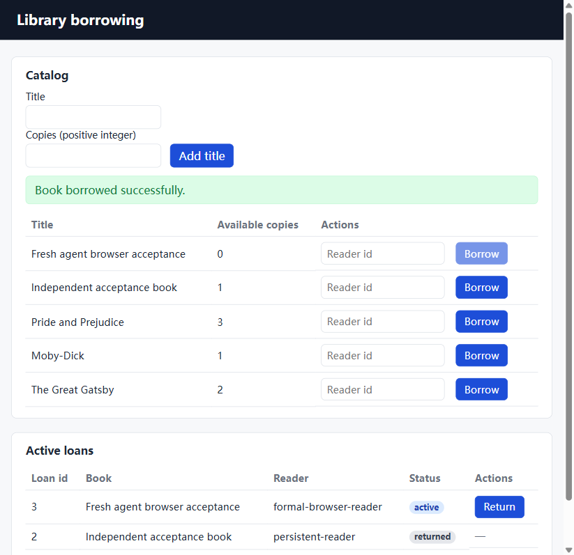
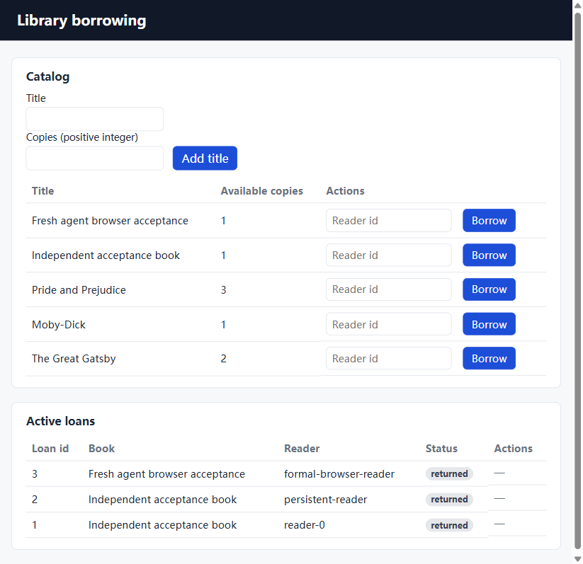

# v0.2 冻结实验结果

正式 cohort 为 `20261106-v02-e3`，控制器与输入冻结在 `2d986eb8e26f79e438b9ee0962963071e08197ff`。九次均已结束，未重跑、未人工修改生成源码；最终文件清单完整性核验通过。使用百炼 `deepseek-v4-pro-0813`。

| 案例 | 修复上限 | 完整自动验收通过 | 有效 usage 费用估算（元） |
| --- | ---: | ---: | ---: |
| 借阅 | 0 | 0/3 | 13.345434 |
| 借阅 | 3 | 3/3 | 39.374874 |
| Space Fractions | 3 | 0/3 | 152.044074 |

合计有效响应估算 **204.764382 元**，按输入9、输出27元/百万 tokens 计算；不含其他开发调用、连接测试及不能确认实际用量的请求预留，不是服务商账单。

| 试验 | 案例 / 修复上限 | 自带测试通过 / 失败 / 跳过 | 结果 |
| --- | --- | --- | --- |
| 1 | Space / 3 | 66 / 1 / 0 | Keycloak realm 导入失败 |
| 2 | Space / 3 | 86 / 0 / 0 | Keycloak realm 导入失败 |
| 3 | Space / 3 | 82 / 0 / 0 | 登录可用，伪造签名请求超时 |
| 4 | 借阅 / 0 | 0 / 1 / 0 | 测试及追溯检查失败 |
| 5 | 借阅 / 3 | 59 / 0 / 0 | 自动检查及12项独立HTTP通过 |
| 6 | 借阅 / 0 | 0 / 1 / 0 | 缺失数据库 bind 源等问题 |
| 7 | 借阅 / 3 | 35 / 0 / 0 | 自动检查及12项独立HTTP通过 |
| 8 | 借阅 / 0 | 无完整可运行测试结果 | 缺少根 package.json 等问题 |
| 9 | 借阅 / 3 | 47 / 0 / 0 | 自动检查及12项独立HTTP通过 |

原始输出、逐项检查、耗时、模型轮次及哈希见 [离线审阅页](../experiments/v02/20261106-v02-e3/review.html) 和同目录 JSON。自带测试数量由模型生成，案例间测试集合不同，不能拿测试数量比较正确率。HTTP检查器位于项目之外；失败时不会继续运行所有后续检查，不能用部分通过数替代完整验收。

第一份完整通过的全新借阅项目（试验5）另做浏览器检查：新增一本、借出后库存为0、借阅按钮禁用、归还后库存恢复、刷新后归还状态保留。独立HTTP另检查库存不足及并发行为。页面的“Active loans”标题仍包含归还历史，但状态与操作按钮正确，作为文案问题保留，未手工修源代码。首次浏览器连接因 WSL 空闲退出中断；保持本次 WSL 会话后重新完成检查，不归因为生成项目失败。

可直接审阅 [该项目的完整源码和来源](../examples/library/README.md)。它与开发期借阅续跑、v0.1 人工修正的 Space Fractions 副本分别记录。

第三份 Space 输出另起一个 seed 续跑，三轮后仍失败：43轮模型调用、1541.36秒，有效usage估算15.782346元。最终鉴权文件首行出现重复引号，静态、单元和构建失败，运行检查因语法失败标记未验证，网页未尝试。集成脚本虽退出0，但实际执行0项测试，不构成功能覆盖。该结果单独记录，不改变这里的0/3；见 [完整追加修复记录](../experiments/v02/extra-repair/summary.json)。在归档的 project 运行 `node --check src/gateway/auth.js` 可复现首个语法错误。e1截断中止、e2夹具问题及合作取消也保留在各自 cohort，没有混入这九次成功计数。

这些是固定顺序、每组3次的小样本可行性观察。未随机化，不作统计显著性、普遍成功率或多智能体优势声明。两组均可在生成阶段调用检查工具，0轮仅关闭宿主最终验证后的反馈修复，不能解释为完全没有检查。重复读取指标按阶段计数；写入次数包含同一文件的多次版本，不等于生成文件数量。

## 最终工具构建与费用

最终回归78通过、1跳过；跳过为Windows符号链接权限。干净Windows验收完成：独立exe双击、中文/空格路径、原文解析、0813连接、小任务真实生成、取消和结果入口均已验证。小任务输出14文件、22轮，但缺少Node/Docker，项目执行保持未验证。详见 [干净Windows报告](clean-windows.md)。

正式实验后仅修改GUI的DPI/滚动和输入法焦点处理，以及API证书包、脱敏网络诊断和依赖声明；最终源码与exe清单另存。九次实验继续对应冻结版本，不用其结果直接宣称修改后完整版本的普遍成功率。微软拼音组合候选仍需英文输入/粘贴规避，已列为已知限制。

| 费用范围 | 有效usage估算元 | 未知预留元 |
| --- | ---: | ---: |
| 宿主全部历史（含v0.1、开发、正式九次和追加修复） | 442.544415 | 8.982771 |
| 独立干净Windows来宾 | 1.245669 | 0.747660 |
| 两账本合计 | 443.790084 | 9.730431 |

正式九次204.764382元、追加修复15.782346元已包含在宿主历史中，不能再叠加。历史请求按各自已记录价格计算；来源为 [宿主费用](../experiments/v02/fees-host.json) 和 [来宾费用](../experiments/v02/clean-windows/fees.json)，不是服务商账单。未知请求未清零。GitHub Actions因账户账单锁定未执行，78项测试及打包在本机完成。
