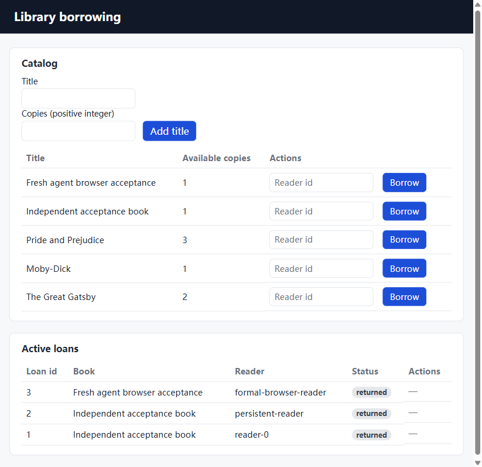

# 全新自动生成的借阅项目

本例来自冻结实验 e3 的第5次任务：从空目录生成，最多三轮宿主反馈修复，没有人工修改生成源码。按试验顺序选择首个完整自动检查通过的借阅结果；其余八次结果也全部保留。

- 项目自带测试：59通过、0失败、0跳过。
- 项目外真实 Docker/HTTP：12项通过，包括并发库存、重复归还和重启持久化。
- 真实浏览器：新增、借出、零库存禁用、归还及刷新后状态复验通过。
- 已知文案问题：“Active loans”表同时列出 returned 历史；行状态和操作正确。这不等于完整界面或架构语义已无缺陷。

`project/`逐文件字节与该次原始报告一致，含宿主通过 npm 派生的锁文件。`origin.json`提供来源、文件哈希及人工介入记录；`raw-report.json`保持原始报告，包括该次实际模型用量与检查输出。完整事件和每次修改快照在 v0.2 证据包的相应 run 目录。

运行方式见 [生成项目原始 README](project/README.md)。在本仓库也可执行：

```powershell
python scripts/serve_generated.py examples/library/project --profile library --artifacts .local/library-demo --stop-file .local/library-demo/STOP
```

命令需要 Node/Docker开发环境；成功预检后打印实际浏览器地址，创建指定STOP文件即可停止并清理该次临时环境。桌面Agent自带Python，不代表生成项目无需这些依赖。


